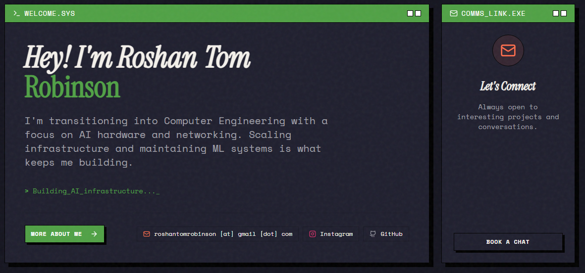

# Roshan's Portfolio

I’m Roshan Tom Robinson, and I plan to study computer engineering. This portfolio brings together my earlier web projects and the questions I want to explore in embedded systems, data centers, and networking.

   

## Learning plans

The Skills page covers the languages and tools I want to use, including C and C++ for firmware, Python and Bash for automation, Linux for servers, and Wireshark for inspecting network traffic. The home page sketches a first experiment that connects those interests by sending sensor readings from an ESP32 to a Linux server.

The About page expects the downloadable résumé at `public/resume/roshan-tom-robinson-resume.pdf`.

## Design

This portfolio draws heavy design inspiration from the retro-summer aesthetic of [Poolsuite](https://poolsuite.net/) and the bento-box dashboard layout of [Jason Cameron's Portfolio](https://jasoncameron.dev/). 

I built this version with help from AI coding assistants for styling and layout debugging.

---

Thanks for visiting.
